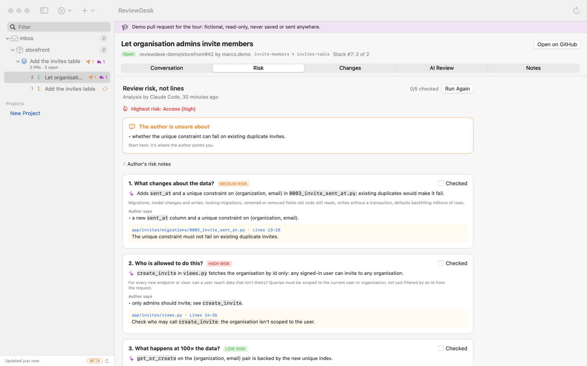
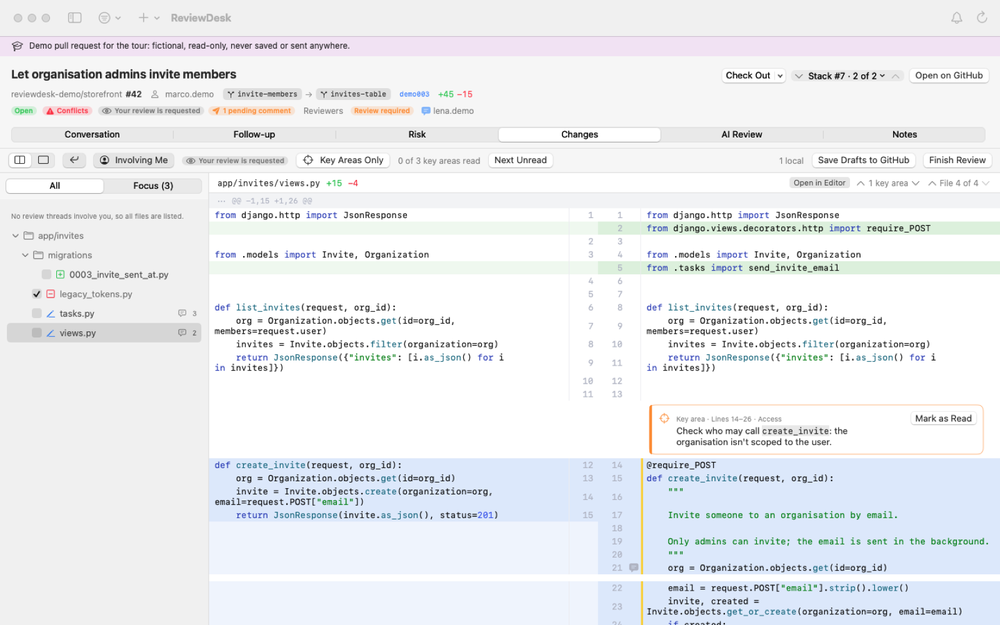
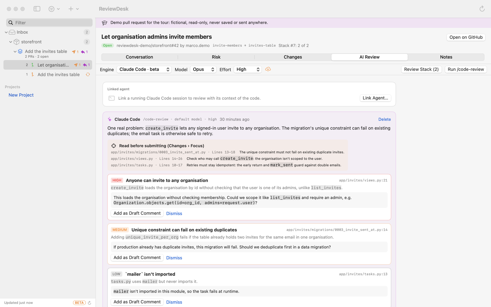
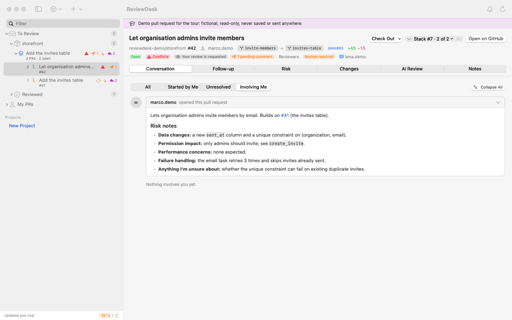
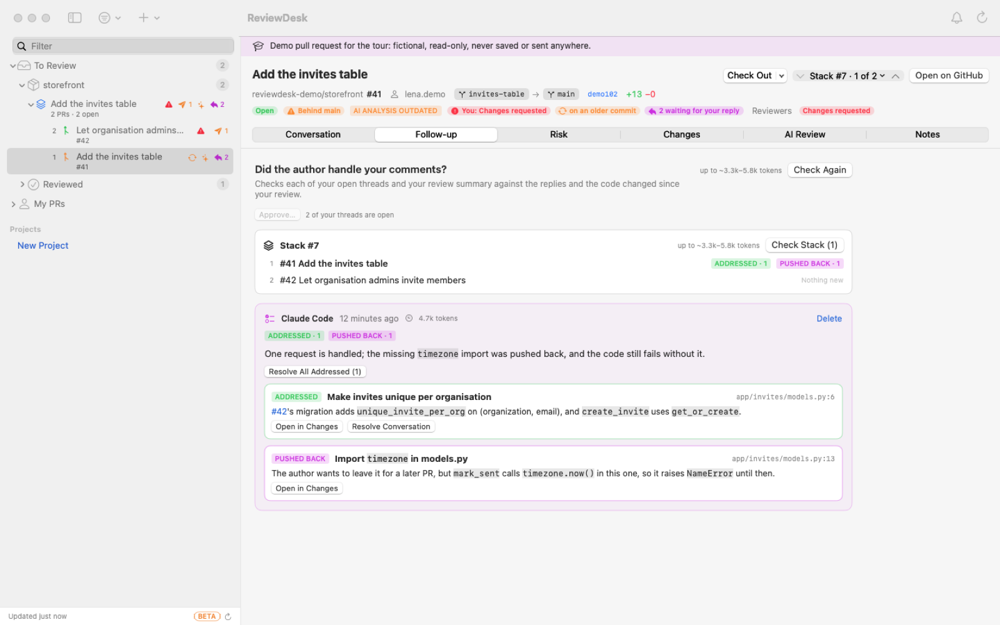

# ReviewDesk

> **Beta preview.** ReviewDesk has no stable release yet: every version is a preview build. Claude Code support is beta; Codex and Ollama are alpha.

A native macOS app for reviewing GitHub pull requests: a private inbox with local projects and folders, native GitHub stacks, manual and AI-assisted review, drafts saved to your pending GitHub review, and update notifications.

There is no backend. Notes, folders, drafts and AI results stay in `~/Library/Application Support/ReviewDesk/`. GitHub is reached only through the `gh` CLI. Code goes to a cloud AI provider only when you run a review or click *Explain* on a comment with Claude Code or Codex.

## Screenshots

Taken from the built-in demo pull request (a fictional repository), with `make screenshots`.

| Risk-first review | Changes, with key areas and inline threads |
| --- | --- |
|  |  |
| **AI review with Claude Code's `/code-review`** | **Conversation** |
|  |  |
| **Follow-up: did the author handle your comments?** | |
|  | |

## Requirements

- macOS 14 or later, with Swift 6 (the Command Line Tools are enough; Xcode is not required).
- [`gh`](https://cli.github.com), logged in (`gh auth login`). The active `gh` account is the one ReviewDesk uses.
- Optional, for AI review: `claude` (Claude Code) and/or `codex`, logged in with a subscription, or [`ollama`](https://ollama.com) with a local model. If a CLI is logged in with an API key, ReviewDesk refuses to run it, and it strips API-key environment variables from every child process.

## Install

Download `ReviewDesk-<version>.dmg` from the repository's GitHub Releases, open it and drag ReviewDesk onto Applications.

The app is signed ad hoc, not with an Apple Developer ID, so macOS blocks the first launch of a downloaded copy. Right-click ReviewDesk in Applications and choose **Open** (or use System Settings → Privacy & Security → **Open Anyway**). From Terminal, `xattr -dr com.apple.quarantine /Applications/ReviewDesk.app` does the same. Later launches open normally.

Updates install from the app (*Install and Relaunch*), without that first-launch approval: ReviewDesk downloads the installer through `gh`, checks it against GitHub's checksum and the expected bundle id and version, copies the app out without the quarantine mark, then replaces itself and relaunches.

## Commands

| Command | What it does |
| --- | --- |
| `make test` | Runs the core test suite (`swift test` plus the Swift Testing plugin path the Command Line Tools need). |
| `make app` | Builds a release `ReviewDesk.app` signed ad hoc in the repo root. Notifications only work from this bundle. |
| `make run` | `make app`, then opens it. |
| `make install` | Builds the app, quits the running copy, installs it in `/Applications` and opens it. Run it again to update. |
| `make screenshots` | Rebuilds the app and retakes the README screenshots in `docs/screenshots` from the demo pull request. The run never polls GitHub or saves anything. |
| `make dmg` | Builds a universal (Apple silicon + Intel) `dist/ReviewDesk-<version>.dmg` installer. `VERSION=1.2.0` overrides the version from `Info.plist`. |
| `make icon` | Regenerates `assets/AppIcon.icns` from the drawing in `assets/make-icon.swift`. |
| `swift run ReviewDesk` | Quick debug launch without a bundle (notifications are disabled). |

## Releasing

Every push and pull request runs `.github/workflows/ci.yml`, which builds the app and runs the tests on macOS. To release, rename `## Unreleased` in `CHANGELOG.md` to the version (that section becomes the release's description), then push a version tag: `git tag v0.4.0 && git push origin v0.4.0`. The `Release` workflow in `.github/workflows/release.yml` runs the tests on macOS, builds the universal DMG with that version, and publishes a GitHub Release with the DMG attached. To rebuild an existing tag, run the workflow manually and enter the tag. Keep `CFBundleShortVersionString` in `assets/Info.plist` in step for local builds.

## Layout

- `Sources/ReviewDeskCore`: the testable core. It contains the process runner, the `gh` GitHub client, native stack grouping, the diff parser, pending-review sync, update detection, the AI context builder and the AI CLI adapters.
- `Sources/ReviewDesk`: the SwiftUI app. It contains the window (one sidebar for projects and PRs, plus the PR detail), the menu bar extra, notifications and settings.
- `Tests/ReviewDeskCoreTests`: Swift Testing tests. Every CLI is stubbed through `FakeRunner`.
- `assets/`: `Info.plist` and `AppIcon.icns` for the bundle, plus `make-icon.swift`, which draws the icon.

## How it behaves

- **Inbox:** PRs you authored, are assigned to, or were asked to review, plus any PR added by URL. Everything seen is monitored until you choose *Stop Monitoring*.
- **Stacks:** these come from GitHub's native stacked PRs (`gh stack`) and are shown bottom first. Folders hold a standalone PR or a whole stack.
- **Reviews:** drafts are local until *Save to GitHub as Pending*. They are then added to your existing pending review through GraphQL, never recreated. Publishing needs an explicit Comment, Approve or Request Changes choice. After a timeout, writes are reconciled against GitHub before a retry.
- **Changed since review:** an open PR you reviewed whose head moved since your latest review (a dismissed review counts too) gets its own state: an orange badge and icon, a "new commits since your review" marker, and a *Changed Since Review* entry in the sidebar's state filter.
- **Updates:** at launch and every 6 hours ReviewDesk asks GitHub (through `gh`) for the latest release of `MicheleSottocasa/underReview`. When it's newer than the running version, a banner at the bottom of the sidebar offers *Install and Relaunch*, *Notes* (the release page) or *Later* (hidden until the next version), and one system notification is posted per version. Installing is refused while an AI review runs, since relaunching would cancel it. *ReviewDesk › Check for Updates…* checks on demand; Settings › General shows the version and can turn automatic checks off.
- **Polling:** every 180 s while active and 600 s in the background by default (adjustable in Settings, never under 60 s), with backoff on errors (up to 30 min). The first load raises no notifications. The bottom of the sidebar shows when the list was last fetched, a spinner while it runs and the error if it failed, with a button to refresh now. Closing the window keeps the menu bar item running, and *Quit* stops monitoring.
- **Tour:** on first launch (and from *Help › Show Tour*) a guided tour walks every area on a demo stack of two fictional pull requests, before you connect your own. The demo lives in memory only: it's never saved, never refreshed from GitHub, and actions that would reach GitHub or an AI provider are turned off on it.
- **Follow-up:** when the author pushes after your review or replies to one of your comments, a note under the PR header and a *Follow-up* tab offer *Check if addressed*. The AI gets your open threads (with the replies), your review summary and only the code changed since your review (GitHub's compare; the whole diff if that commit is gone), and returns one verdict per request: addressed, partly, not addressed, pushed back or unclear, with the evidence. Addressed threads can be resolved from there. Results are kept like AI reviews and marked when newer commits arrive. In a stack, the tab lists every pull request with its latest result, and *Check Stack* checks all those with something new since your review, bottom first, skipping the rest.
- **Chat about a comment:** ✨ *Explain* answers what a comment means and then takes follow-up questions; 💬 *Ask* starts with your own question. Both send the PR description, the comment's conversation and its file's diff, and every follow-up resends that same context.
- **Findings:** *Add to Pending Review* puts a finding about code straight into your pending GitHub review as an inline comment: on its line, or on the nearest line GitHub accepts a comment on, naming the line it meant. Only you see it until you submit the review. General remarks, and files without a diff, go into the review summary.
- **Review Stack:** gives every open pull request of a stack its own agent, several at once (3 by default, set in Settings › AI; Ollama runs one at a time). The progress box lists each pull request with its agent's state and live log, wherever you look at it: on the pull request you started from or on any member. Rows open their pull request; each agent can be stopped alone, or all at once.
- **AI review with Claude Code:** runs Claude Code's own `/code-review` on the PR, with the model and effort you pick (the last used are remembered). It runs in restricted mode, in an empty temporary directory (or the linked session's folder), with MCP off. Its only tools are reading files and `gh pr diff` / `gh pr view`. Anything else, including any write, is denied without asking. Its steps (commands run, files read, refused calls) stream into the AI and Risk tabs while it works. To follow the command's helper agent live, the run's Claude Code session is kept on disk until it ends and then deleted.
- **Repository rules:** every review checks the change against the repository's own rules, read from the PR's base branch: `AGENTS.md`, `CLAUDE.md`, `CONTRIBUTING.md`, `.github/copilot-instructions.md` and `.cursorrules` at the root, plus nested `AGENTS.md`/`CLAUDE.md` in folders the PR touches. Violations come back as findings quoting the rule. With `/code-review` they're checked in the second pass (the command's helper agent doesn't take extra instructions); *Prepare Context* lists them so you can deselect any.
- **AI review with Codex or Ollama:** *Prepare Context* shows exactly which files go into a review, plus a token estimate and the budget. Nothing is truncated silently. The CLIs run in an empty temporary directory with tools, hooks, plugins and MCP disabled.
- **Risk:** a tab that walks the review as five risk questions, in order: what changes about the data, who is allowed to do this, what happens at 100× the data, what happens when it fails, and whether the author can explain it. *Run Risk Analysis* has the AI answer each question with a level (not touched, low, medium, high) and the evidence; with Claude Code it starts `/code-review` straight away, while Codex and Ollama go through *Prepare Context* first. Each question also shows the author's *Risk notes* from the PR description (*Copy PR Template* gives authors the section), the AI's key areas tagged with that question, and a checkbox that resets after a push. It warns when data-layer files changed but no data risk was flagged, and can add a request to explain the approach to your review summary.
- **Focus:** each review also names the key files and sections to read before submitting. *Changes › Focus* lists them, together with every file that has comments you haven't submitted.
- **Settings:** refresh intervals, diff layout, AI engine and model, and the text of every AI prompt (the `/code-review` instructions, the Codex/Ollama review prompt and the Explain prompt). Result formats are enforced separately, so a custom prompt can't break parsing.

## Not in v1

Merge, rebase or push from the app. Creating or editing stacks. Multiple GitHub accounts. Sync between devices. Submodule and LFS content in AI context. Distribution beyond a local build.

## License

All rights reserved. You may download and use ReviewDesk for any purpose, including at work, but not modify, redistribute or sell it. See [LICENSE](LICENSE).
